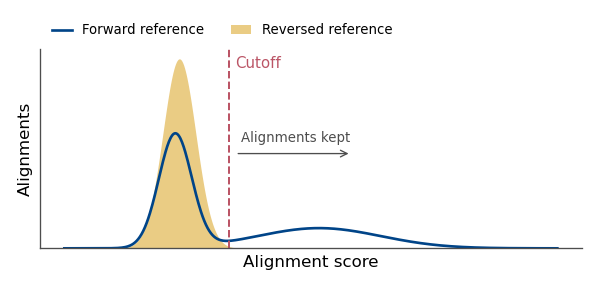

# QutRNA2

Robust tRNA modification discovery from Nanopore direct tRNA sequencing

[](https://github.com/dieterich-lab/QutRNA2/actions/workflows/ci.yaml)
[](https://doi.org/10.1093/nargab/lqag065)
[](https://doi.org/10.5281/zenodo.18667756)

If you use QutRNA2, please cite: [https://doi.org/10.1093/nargab/lqag065](https://doi.org/10.1093/nargab/lqag065)


QutRNA2 compares two conditions, position by position:

1. Reads are mapped with [gpu-tRNA-mapper](https://github.com/fkallen/gpu-tRNA-mapper), up to 25x faster than the previously used mapper [parasail](https://github.com/jeffdaily/parasail).
2. Adapter-overlapping and multimapping alignments are removed, as are alignments that score no better than alignments to a reversed reference.
3. Mismatches, deletions, and insertions are scored with [JACUSA2](https://github.com/dieterich-lab/JACUSA2).
4. Each site's JACUSA2 score is corrected with a permutation test to report a normalized score, plus a Benjamini-Hochberg False Discovery Rate (FDR) from the p-value.

## Contents

- [Quick start](#quick-start)
- [Requirements](#requirements)
- [Configuration](#configuration)
- [Run QutRNA2](#run-qutrna2)
- [Outputs](#outputs)

## Quick start

The container image is the recommended way to run QutRNA2. Every tool and version is fixed in it.

1. Get the code and build the image.
   ```console
   git clone https://github.com/dieterich-lab/QutRNA2
   cd QutRNA2
   singularity build --fakeroot qutrna2.sif singularity/qutrna2.def
   ```
   Building needs root or `--fakeroot`. Some HPC clusters do not allow `--fakeroot`; build on another machine and copy the image over.
2. Copy the examples. Edit them as described under [Configuration](#configuration).
   ```console
   cp examples/analysis/map_with_gpu.yaml my_analysis.yaml
   cp examples/data/data_auto.yaml my_data.yaml
   cp examples/sample_table_fastq.tsv my_samples.tsv
   ```
3. Do a dry run. It checks the configs and lists the jobs. `--bind` must cover your data.
   ```console
   singularity run --nv --bind <DATA_DIR> qutrna2.sif snakemake -n -c 1 --snakefile workflow/Snakefile --configfiles my_analysis.yaml --config pepfile=my_data.yaml --directory my_run
   ```
4. Run it. Drop `-n`, and set `-c` to your number of cores.
5. Open `my_run/results/report/report.html`.

## Requirements

- Singularity or Apptainer, or conda (see [Run QutRNA2](#run-qutrna2)).
- An NVIDIA GPU, Volta or newer. See the [hardware requirements](https://github.com/fkallen/gpu-tRNA-mapper?tab=readme-ov-file#hardware-requirements).
- Without a GPU, use `examples/analysis/map_with_parasail.yaml`. Reads are then mapped on the CPU, much more slowly.

## Configuration

A run needs three files.

| file | content | template |
|---|---|---|
| sample table | one row per FASTQ or BAM file | `examples/sample_table_fastq.tsv` |
| data YAML | reference, linkers, contrasts, Sprinzl setup | `examples/data/*.yaml` |
| analysis YAML | mapper, filters, JACUSA2, extra heatmaps | `examples/analysis/*.yaml` |

Sample table:

- The columns are `condition`, `sample_name`, `subsample_name`, `base_calling` and `fastq` (or `bam`).
- `fastq` is a gzipped FASTQ file.
- Set `base_calling` to `pass`. It is a legacy column.
- Rows with the same `sample_name` are pooled into one sample, e.g. FASTQ parts of one run.
- Samples with the same `condition` are its replicates in JACUSA2 and the permutation test.
- For mapped reads, use `bam` (template `examples/sample_table_bam.tsv`) with the analysis template `examples/analysis/existing_mapping.yaml`.

Data YAML:

- `ref_fasta.file` is the tRNA reference, linkers included. For example, from [GtRNAdb](https://gtrnadb.ucsc.edu/).
- Set `linker5` and `linker3` to the adapter lengths in your reference.
- Wrong linker lengths shift every coordinate.
- `contrasts` lists the condition pairs to compare.

Analysis YAML:

- `alignment.method` is `gpu` or `parasail`.
- Commands to run before mapping go in `gpu.pre`, e.g. loading a CUDA module.
- `gpu.bin` and `jacusa2.jar` are the tool paths, if they are not on your PATH.
- The filters are switched on under `filter`: random alignments, adapter overlap (5' and 3' linkers), multimappers.
- Random alignments: reads are also aligned to a reversed reference. The cutoff is the lowest score at which at least `alignment.precision` (default 0.999) of the kept alignments are to the forward reference.



- Read-count, read-length and heatmap plots are added under `plots`.

Each `plots.heatmap` entry is one normalized heatmap per contrast. Its options are commented in `examples/analysis/map_with_gpu.yaml`.

All options and their defaults are in `workflow/schemas/config.yaml` and `workflow/schemas/pep.yaml`.

### Sprinzl coordinates

| approach | data YAML key | template |
|---|---|---|
| automatic, with [sprinx](https://github.com/dieterich-lab/sprinx) (recommended) | `sprinzl.scheme` | `data_auto.yaml` |
| your own covariance model | `sprinzl.cm`, `sprinzl.labels` | `data_cm.yaml` |
| an aligned FASTA | `sprinzl.afasta` | `data_afasta.yaml` |
| a sequence-to-Sprinzl table | `sprinzl.seq_to_sprinzl` | `data_seq_to_sprinzl.yaml` |

- `scheme` is `euk`, `arch`, `bact` or `mito`. `mito` allows for tRNAs that lost an arm.
- Default models come with sprinx. Override them with `sprinzl.mito.canonical_cm` and `sprinzl.mito.armless_cm_dir` (for `mito`), or `sprinzl.cyto.cyto_cm_db`.
- The amino acid and anticodon are read by sprinx from each tRNA ID. The ID is the header up to the first space.
- The ID must have the form `id|aa|anticodon|taxon`, or a GtRNAdb-style name like `tRNA-Ala-TGC`.
- Rename mitochondrial gene symbols. For example, `mt-Ta` becomes `mt-tRNA-Ala-TGC`.
- Every ID is checked before the run starts.
- `ignore_trnas` is a regex of tRNAs to leave out of Sprinzl labelling. They then drop out of the plots. Use `^mt-` for a nuclear run.
- The plotted labels and their order are set in `sprinzl.labels`. A `-` drops a position.

Bundled files:

- `data/TRNAinf-euk.cm` (from [tRAX](https://github.com/UCSC-LoweLab/tRAX/blob/master/TRNAinf-euk.cm)) with `data/nuclear-euk-masked.txt`, for eukaryotic nuclear tRNAs, as in the paper.
- `data/human_mt_seq_to_sprinzl.tsv`, for human mt-tRNAs ([Suzuki et al. 2020](https://www.nature.com/articles/s41467-020-18068-6)). Its plotted labels are in `data/human_mt_sprinzl_labels.txt`.
- More covariance models are in [tRNAscan-SE](https://github.com/UCSC-LoweLab/tRNAscan-SE/tree/master/lib/models).

## Run QutRNA2

**Container (recommended).** Download the image from Zenodo (if using v2.0.0 as in our manuscript), or build it (later versions):
```console
singularity build --fakeroot qutrna2.sif singularity/qutrna2.def
singularity run --nv --bind <DATA_DIR> qutrna2.sif snakemake --cores <N> --snakefile workflow/Snakefile --configfiles my_analysis.yaml --config pepfile=my_data.yaml --directory my_run
```
- `--nv` makes the GPU available in the container.
- `--bind` must cover every path in your configs.

**Conda.** Create the environment, then run the same Snakemake command with `--use-conda`:
```console
conda env create -f conda.yaml -n qutrna2
conda activate qutrna2
snakemake --cores <N> --use-conda --snakefile workflow/Snakefile --configfiles my_analysis.yaml --config pepfile=my_data.yaml --directory my_run
```

**Cluster.** There are two options:

- Submit the command above as one job. Add `--executor local`: the job already has its resources, and Snakemake runs the rules inside it. Set `--cores` to the job's CPUs (e.g. `$SLURM_CPUS_ON_NODE`).
- Or let Snakemake submit each rule, with a profile. `workflow/profile/slurm-cluster/` is a SLURM example. Partitions, accounts and threads go in the profile.

## Outputs

All paths are inside the run directory (`--directory`). Each contrast gets its own folders. For example, for `wt` against `KO`:

```
results/jacusa2/cond1~wt/cond2~KO/bam~final/          JACUSA2.out, score tables, permutation.tsv
results/plots/normalized/cond1~wt/cond2~KO/bam~final/ normalized_heatmap.pdf, all tRNAs
results/plots/normalized/cond1~wt/cond2~KO/<id>/bam~final/ normalized_heatmap.pdf, one per plots.heatmap entry
results/plots/scores/cond1~wt/cond2~KO/<id>/bam~final/ one folder per entry with subsampled: true
```

| path | content |
|---|---|
| `results/report/report.html` | heatmaps, read counts, configs, versions and file paths |
| `results/bam/{mapped,filtered-*,final}/` | alignments per filter step, by sample and subsample |
| `results/stats/` | read counts, lengths and alignment scores per filter step |
| `results/ss/seq_to_sprinzl_filtered.tsv` | the Sprinzl mapping used |
| `results/cmalign/align.stk` | the structure alignment, with a covariance model |
| `results/data/` | the processed reference |
| `data/` | the inputs, as the run read them |
| `logs/`, `info/` | job logs, configs and versions |

### Report

The report has five tabs:

- **Overview**: run directory, configs, filters, sample table, tool versions and commits.
- **Preprocessing**: read counts and lengths after each filter.
- **Results**: one sub-tab per contrast. First the normalized heatmap of all tRNAs, then one per `plots.heatmap` entry.
- **Files**: paths to BAMs, score tables, permutation tables and all plots, including those the report does not show.
- **Configuration**: the YAML files of the run.

Images are embedded. The file is self-contained and can reach tens of MB.

### Normalized heatmap

- At each position, the reads of all replicates are pooled.
- They are dealt back at random. Each replicate keeps its depth.
- Each permutation is scored like the data.
- A tile's colour is the observed score minus the highest permuted score. It is summed over mismatches, deletions and insertions.
- The p value is the share of permutations that score at or above the data.
- One Benjamini-Hochberg correction is applied over all three error types. Three FDRs are given per position: mismatch, deletion and insertion.
- A position is called when any of its three FDRs is below `jacusa2.fdr` (default 0.05). Called positions are drawn as large tiles.
- The number of permutations is set in `jacusa2.permutation`.
